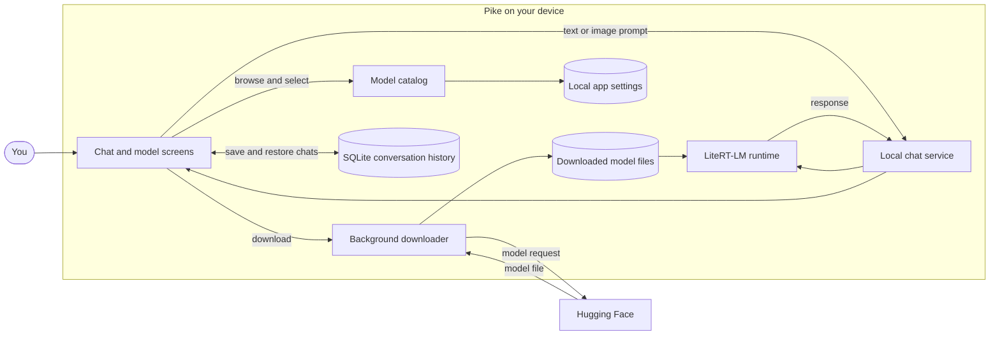

<div align="center">

  

  # Pike

  **Chat with AI models that run on your device.**

  Download local models, keep conversations on-device, and ask questions about images with supported vision models.

  
  

</div>

## What you can do

- Download and manage local LiteRT-LM models.
- Chat on-device without sending prompts to a hosted AI service.
- Attach an image when using a vision-capable model.
- Save conversations locally, then reopen, rename, or delete them.
- Clear all saved conversations from Settings.

An internet connection is needed to download models. After downloading, inference runs locally. Models take significant storage space; the approximate download sizes are listed below.

## Models

| Model | Parameters | Input | Approx. download |
| --- | ---: | --- | ---: |
| Gemma e2B | 2B | Text | 2.59 GB |
| Gemma e4B | 4B | Text | 3.66 GB |
| Qwen3 0.6B | 0.6B | Text | 498 MB |
| Qwen2-VL 2B | 2B | Text and images | 1.78 GB |
| InternVL3 1B | 1B | Text and images | 738 MB |

Models are downloaded from Hugging Face. The model catalog, source URLs, and size information are maintained in [`lib/Utilities/models.dart`](lib/Utilities/models.dart).

## How it works



## Run the app

### Requirements

- Flutter SDK with Dart **3.12.2 or newer**.
- Android SDK and an Android device or emulator.
- Internet access and sufficient device storage to download models.

### Start

```sh
flutter pub get
flutter run
```

Open **Models**, download a model, and select it before starting a chat. The image attachment control is shown for models that support vision.

## Build for Android

Build a separate release APK for each supported CPU architecture:

```sh
flutter build apk --split-per-abi --release
```

Find the APKs in `build/app/outputs/flutter-apk/` and install the one matching the target device. For Google Play, build an Android App Bundle:

```sh
flutter build appbundle --release
```

The current Android release configuration uses debug signing. Set up a production signing key before publishing.
