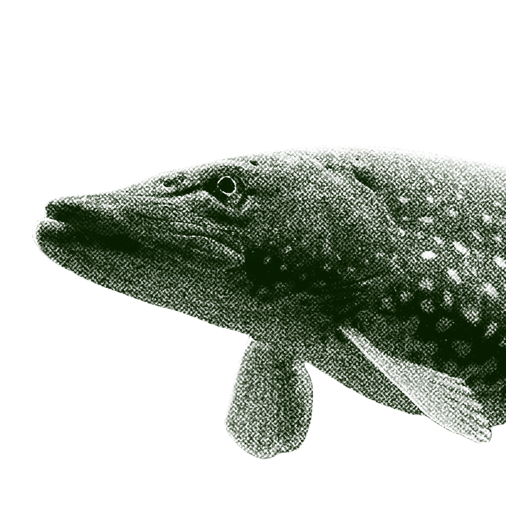
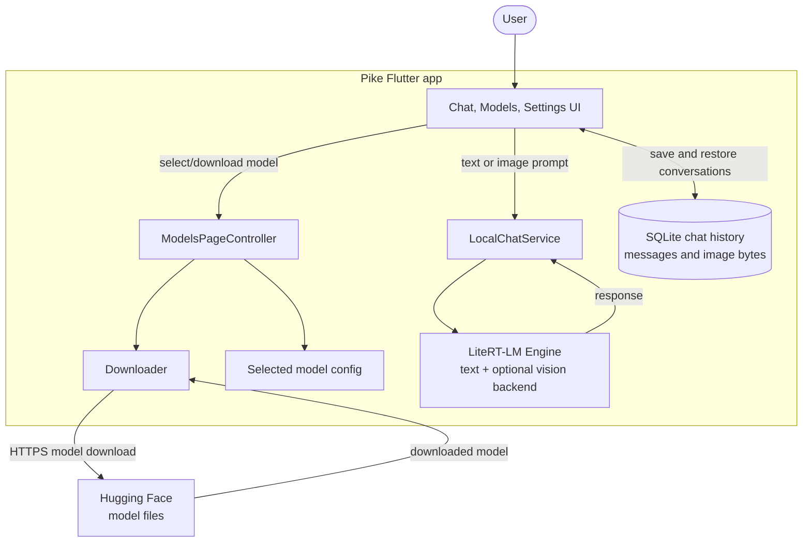

<div align="center">

  

  # Pike

  **Private, on-device AI chat for Android**

  Download local language models, chat without sending prompts to a hosted AI service, and use images with supported vision models.

  
  
  

</div>

## Features

- Download, select, and remove LiteRT-LM models.
- Run text inference locally on the device with LiteRT-LM.
- Attach images to prompts when a vision-capable model is selected.
- Save conversations and image attachments locally; reopen, rename, or delete chats.
- Clear all saved chat history from Settings.
- Download models from Hugging Face with background download progress.

Model downloads require an internet connection. Once downloaded, text and image inference runs on-device.

## Supported models

| Model | Parameters | Modalities | Approx. download size |
| --- | ---: | --- | ---: |
| Gemma e2B | 2B | Text | 2.59 GB |
| Gemma e4B | 4B | Text | 3.66 GB |
| Qwen3 0.6B | 0.6B | Text | 498 MB |
| Qwen2-VL 2B | 2B | Text, vision | 1.78 GB |
| InternVL3 1B | 1B | Text, vision | 738 MB |

Model availability, sizes, and source URLs are defined in [`lib/Utilities/models.dart`](lib/Utilities/models.dart).

## Architecture



## Requirements

- Flutter SDK with Dart **3.12.2 or newer** (the Dart constraint is in `pubspec.yaml`).
- Android SDK and a connected Android device or emulator.
- Internet access to download models from Hugging Face.

Downloaded models are large and require additional free space on the device. Chat history, settings, and downloaded model files are stored locally.

## Run from source

```sh
flutter pub get
flutter run
```

Choose a model in the **Models** tab and download it before starting a chat. The image attachment button is available for vision-capable models.

## Build for Android

Build separate release APKs for the supported CPU architectures:

```sh
flutter build apk --split-per-abi --release
```

The APKs are written to `build/app/outputs/flutter-apk/`. Install the APK matching the target device architecture. For Google Play distribution, build an Android App Bundle instead:

```sh
flutter build appbundle --release
```

Release builds currently use the debug signing configuration in `android/app/build.gradle.kts`. Configure a production signing key before publishing.

## App details

- Android application ID: `com.ravish.pike`
- Display name: **Pike**
- Current version: **1.0.0** (build `1`)
- Inference runtime: [LiteRT-LM](https://pub.dev/packages/litertlm)
- Model hosting: [Hugging Face](https://huggingface.co/)

## Contributing

Bug reports and feature requests are welcome in [GitHub Issues](https://github.com/Ravish-Vishwakarma/Pike/issues).
